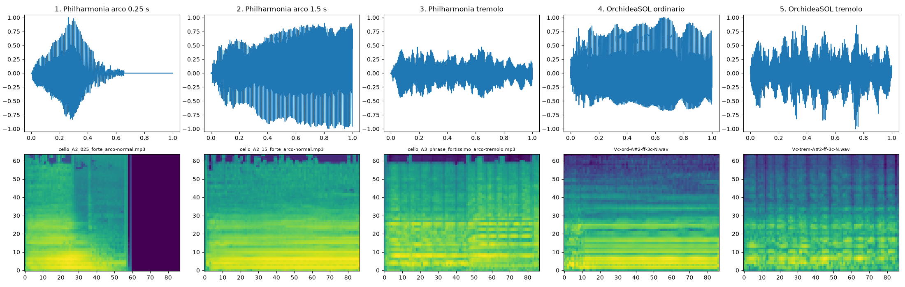
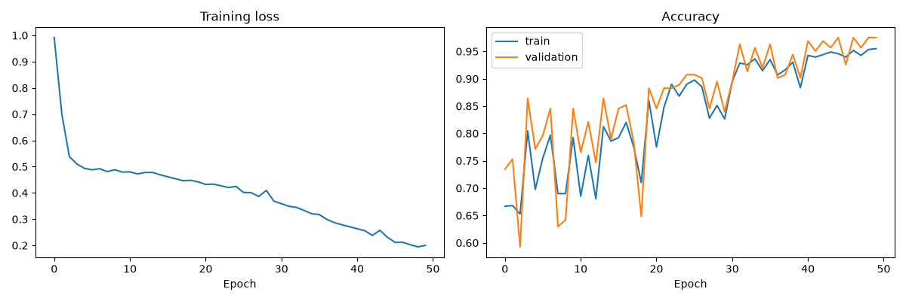
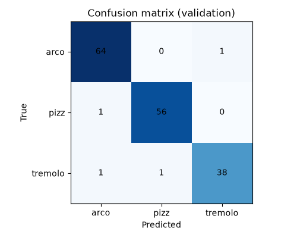
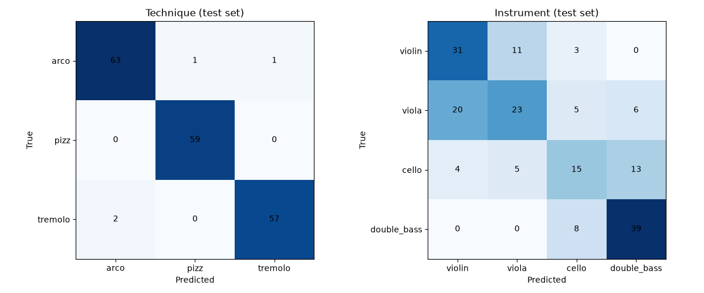

# String Technique Classifier

A small PyTorch model that listens to **one second** of a bowed string instrument and says which playing technique it is:

- **arco** (normal bowing)
- **pizzicato** (plucking)
- **tremolo** (very fast bowing)

## Why I made this

I am a cellist and a music engineering student. I want to build AI systems that can listen to a musician and play together with them, like a real ensemble partner. To do this, a computer first needs to understand **how** a musician is playing, not only **which notes** they play. This project is my first step in that direction.

## Data

| Dataset | Instruments used | Used for |
|---|---|---|
| [Philharmonia Orchestra samples](https://philharmonia.co.uk/audio-sound-samples/) | violin, viola, cello, double bass | training |
| [OrchideaSOL](https://forum.ircam.fr/projects/detail/orchideasol/) (IRCAM) | violin, viola, double bass | training (v3 only) |
| OrchideaSOL | **cello** | **final test only** — never used for training |

The audio files are **not** included in this repository because of the data licenses. You can download them from the links above.

## Method

1. **Preprocessing.** For each sound: make the loudest point equal to 1 (normalize), remove the silence at the start, then cut or pad the sound to exactly 1 second (44,100 samples).
2. **Features.** Turn each sound into a mel spectrogram (64 mel bands × 87 time frames).
3. **Model.** `StringNet`, a small CNN with two convolution layers (about 1,300 parameters).
4. **Training.** 50 epochs, Adam optimizer, learning rate 0.001. 80% of the data for training, 20% for validation.

## Experiments and results

The final test uses **cello** recordings from OrchideaSOL. The model never heard these recordings during training.

| Version | What changed | Arco | Pizz (l.v.) | Pizz (secco)* | Tremolo |
|---|---|---|---|---|---|
| v1 | Philharmonia only | 12% | 95% | 100% | 89% |
| v2 | Remove short arco notes | 20% | 97% | 100% | 78% |
| v3 | Add OrchideaSOL violin, viola and double bass | **100%** | **99%** | **100%** | **85%** |

\* *Secco pizzicato (a short, dry pizzicato) is never used for training in any version. It tests if the model understands pizzicato in general.*

### v1: the model found a shortcut

v1 recognized pizzicato very well, even on low cello notes. But it called almost every arco note "tremolo" (only 12% correct).

To find the reason, I tested the v1 model on Philharmonia arco notes of different lengths:

| Arco note length | Correct |
|---|---|
| 0.25 s | 93% |
| 0.5 s | 92% |
| 1 s | 75% |
| 1.5 s | 49% |

**The longer the arco note, the more often the model makes a mistake.** Many Philharmonia arco notes are very short, so after padding to 1 second, they end with silence. All tremolo recordings are long. So the model learned a wrong rule:

> "Sound with silence at the end = arco. Sound that fills the whole second = tremolo."

The OrchideaSOL arco notes are long, so the model called them tremolo.



### v2: remove the shortcut

I used only arco notes of 1 second or longer, and changed nothing else. Arco became a little better (12% → 20%), but tremolo became worse. Removing the wrong clue did not teach the model the right clue. The model also had fewer tremolo examples (57) than arco examples (105), so when it was not sure, it guessed "arco".

### v3: more varied data

I added OrchideaSOL recordings of violin, viola and double bass (but **not cello**). Now there are more tremolo examples, and the three classes are more balanced (285 / 285 / 237). Arco on the cello test went from 20% to 100%.





### v4 (extra): technique and instrument at the same time

In v4, one model answers **two questions**: "Which technique?" and "Which instrument?" (violin, viola, cello or double bass). This is called **multi-task learning**. The model shares one CNN body and has two output heads.

To recognize the cello, the model must hear cello during training. So v4 uses all four instruments from both datasets (962 sounds), and the test is different from v1–v3:

- The data is split into training (80%) and test (20%) **by note**. All recordings of the same note on the same instrument (for example, all dynamics of cello A2) are either all in training or all in the test. This stops the model from seeing an almost identical sound before the test (data leakage).
- So the v4 test uses **notes the model has never heard**, but **not** an instrument it has never heard. **The v4 results cannot be compared directly with v1–v3.**

| Question | Test accuracy |
|---|---|
| Technique | **98%** (179 / 183) |
| Instrument | **59%** (108 / 183; random guessing would give 25%) |

| Instrument | Correct | Most often confused with |
|---|---|---|
| Violin | 69% | viola |
| Viola | 43% | violin |
| Cello | 41% | double bass |
| Double bass | 83% | cello |



Almost all instrument mistakes happen between **neighbors**: violin and viola, or cello and double bass. Violin and double bass were never confused. This makes sense to me as a player: neighbors have a large **shared pitch range**, so in that range the model cannot use pitch and must use small differences in timbre. The viola, in the middle of the family, is confused in both directions.

## What I learned as a cellist

Tremolo is still the hardest technique (85%). This makes sense to me as a player. Arco and tremolo both use the bow, so their **timbre** is very similar. Normal arco playing also has small changes in volume, for example at the start of a note or when the bow changes direction. The real difference is the **speed** of these changes: tremolo has many very fast bow changes every second.

## Limitations

- In v3, the training data and the test data both come from OrchideaSOL (the same studio). Only the instrument is different. So this test is easier than a test with completely new recordings.
- The validation set is small, so the validation accuracy changes a lot between epochs.
- The model only knows 3 techniques and only listens to 1 second of sound.
- Some Philharmonia pizzicato files contain more than one note.
- One file could not be read and was skipped (`viola_D6_05_piano_arco-normal.mp3`).
- In the length test for v1, 105 of the arco files had also been used for training.
- The model only answers **"which technique?"**. It does not know **how many notes** are played. For example, a double stop played with the bow is correctly called "arco", but the model cannot tell that two notes are played.
- The model always chooses one of the three techniques, even for sounds that are not string playing (speech, typing, room noise). It has no "other" or "not sure" answer.
- At the start of a phrase, the sudden attack may be classified as pizzicato.
- When an orchestra is playing too (for example, a cello concerto recording), the model hears all instruments together, not only the cello.
- In v4, each dataset probably has only one instrument and one player for each instrument type. So the model may learn "this viola" instead of "violas in general".
- In v4, the sounds are normalized, only 1 second long, and use only 64 mel bands. Some details that help to tell instruments apart (for example, the resonance of the instrument body) may be lost.

## Future work

- Test the model with my own cello recordings (a completely new recording situation).
- Make a real-time version and connect it to Max/MSP, so a live-electronics piece can react to my playing technique.
- Add more techniques, such as sul ponticello and col legno.
- Help the model pay attention to fast changes in volume over time.
- Add an "other" class or a "not sure" answer, so the model does not have to choose a technique for every sound.
- Detect double stops. A double stop is not a new technique: it can be combined with arco, pizzicato or tremolo. So a better design is one model that answers two questions at the same time: "Which technique?" and "How many notes?" (multi-task learning). Octave double stops will be the hardest case, because the upper note's harmonics are already part of the lower note's harmonics.

## How to run

```bash
python3 -m venv .venv
source .venv/bin/activate
pip install torch torchaudio numpy matplotlib soundfile

python prepare_data_v3.py   # build the dataset (change the OrchideaSOL path first)
python make_features.py     # make mel spectrograms
python train.py             # train the model
python test_orchidea.py     # test on OrchideaSOL cello
```

## Try it on your own recording

The trained model (`stringnet.pt`) is included, so you do not need to download the datasets or train the model again.

```bash
python3 -m venv .venv
source .venv/bin/activate
pip install torch torchaudio numpy soundfile

python predict_file.py path/to/your_recording.wav
```

Replace `path/to/your_recording.wav` with the path of your own audio file (WAV or MP3). Tip: type `python predict_file.py ` (with a space at the end), then drag your audio file into the terminal window.

The program moves a 1-second window along the recording (every 0.5 seconds) and prints the technique for each window:

```
  0.0 s  ->  arco
  0.5 s  ->  arco
  1.0 s  ->  pizz
  ...
```

**Please note:** the model was trained on short, single notes recorded in studios. It has not been tested on real musical phrases, other rooms or other microphones yet, so the results may not always be correct. If you try it, I would be happy to hear how it works!

### Live demo (experimental)

You can also let the model listen to your microphone in real time:

```bash
pip install sounddevice
python live_demo.py
```

First, the program records 2 seconds of room noise (please be quiet). It uses this to decide what counts as silence, like a noise gate. Then, every 0.5 seconds, it prints the sound level and the technique of the last 1 second. Press **Control + C** to stop.

## Files

| File | What it does |
|---|---|
| `common.py` | Shared tools: loading audio, preprocessing, the model |
| `count_techniques.py` | Counts how many files each technique has |
| `look_at_sound.py`, `plot_sounds.py` | Look at waveforms and spectrograms |
| `prepare_data.py` | Builds the dataset for v1 / v2 (Philharmonia only) |
| `prepare_data_v3.py` | Builds the dataset for v3 |
| `make_features.py` | Makes mel spectrograms |
| `train.py` | Trains the model and saves figures |
| `test_orchidea.py` | Final test on OrchideaSOL cello |
| `diagnose_duration.py` | Tests the model on arco notes of different lengths |
| `compare_arco.py` | Makes the comparison figure |
| `predict_file.py` | Uses the trained model on any recording |
| `live_demo.py` | Uses the trained model on the microphone in real time (experimental) |
| `prepare_data_v4.py` | Builds the dataset for v4 (all four instruments, with note groups) |
| `train_v4.py` | Trains the v4 multi-task model (technique + instrument) |
| `stringnet_v4.pt` | The trained v4 model |
| `stringnet.pt` | The trained model (v3) |

## Data licenses

- **Philharmonia Orchestra samples:** free to use, but the samples may not be sold or shared "as is".
- **OrchideaSOL:** Ircam Forum License, for education and research only.
- **Code in this repository:** MIT License.
